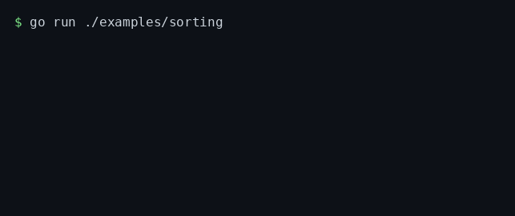

# Nano-Racer

[](https://github.com/wathsalaggg/nano-racer/actions/workflows/tests.yml)

The ultimate **geek playground** for Go developers who want to **race, benchmark, and visualize their functions** down to the **nanosecond**.  



---

## Features

- Measure execution time of your Go functions with **nanosecond precision**  
- Run multiple functions **concurrently** using goroutines  
- Visualize function races in **live ASCII terminal progress bars**  
- Automatically highlight **slowest functions** 


---

## Install

```
go get github.com/wathsalaggg/nano-racer
```

## Usage

```go
package main

import racer "github.com/wathsalaggg/nano-racer"

func main() {
	results := racer.New().
		Lane("plus", withPlus).       // any func() of your own
		Lane("builder", withBuilder).
		Laps(20_000).                 // how many times each one runs
		Run()

	racer.Print(results)
}
```

While it runs you see the race:

```
plus    [####################----------]  67%
builder [##############################] 100%
```

and then the results:

```
1. builder    1.487µs per lap   fastest
2. plus      32.492µs per lap   21.8x slower  <- slowest
```

## Try it

The `examples` folder has four races you can run straight away:

| Command | The race |
|---|---|
| `go run ./examples/basic` | building text with `+=` against `strings.Builder` |
| `go run ./examples/lookup` | finding a number in a slice against a map |
| `go run ./examples/sorting` | bubble sort, insertion sort and Go's `sort.Ints` |
| `go run ./examples/fibonacci` | a function that calls itself against a simple loop |

Start with `basic`. Its comments explain the Go basics that the others
build on.

Run the tests with:

```
go test
```

## A note on accuracy

The lanes run at the same time and share the computer's processors, so
the times are good for comparing functions with each other, not for exact
measurement. For careful benchmarking use Go's built-in `go test -bench`.

## Reading the code

Every file is commented for people who are new to Go. A good order:

1. `racer.go`: time one function
2. `race.go`: lanes, laps and goroutines
3. `bars.go`: the live progress bars
4. `report.go`: the results table
5. `race_test.go`: the tests
6. `examples/basic/main.go`: a program that uses all of it
7. the other examples, in any order

The commit history adds these one step at a time, with an explanation in
each commit message.

## Contributing

Contributions are welcome, including from people who are new to Go or to
open source. See [CONTRIBUTING.md](CONTRIBUTING.md) for how to set up, and
the issues labelled
[`good first issue`](https://github.com/wathsalaggg/nano-racer/issues?q=is%3Aissue+is%3Aopen+label%3A%22good+first+issue%22)
for a place to start.

## Licence

[MIT](LICENSE)
